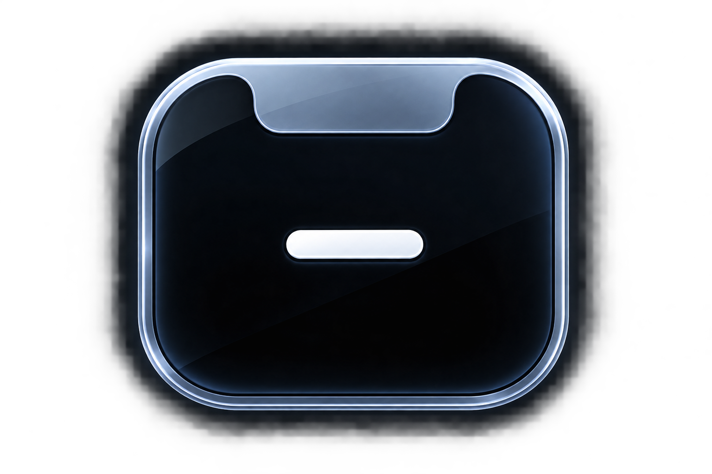
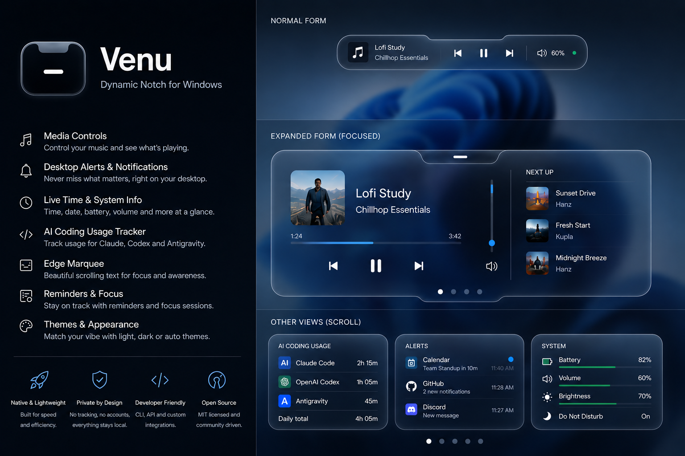

<p align="center">
  
</p>

<h1 align="center">Nova</h1>

<p align="center">
  <strong>Dynamic Notch for Windows</strong>
</p>

<p align="center">
  A native desktop companion for Windows 10 and Windows 11 that brings media, lyrics, notifications, reminders, and clipboard activity into a compact glass notch.
</p>

<p align="center">
  <a href="https://github.com/hfzrfa/venu-notch/releases"></a>
  <a href="https://github.com/hfzrfa/venu-notch/actions/workflows/ci.yml"></a>
  
  
  
</p>

<p align="center">
  
</p>

## What is Nova?

Nova brings a Dynamic Island-style experience to Windows and turns the unused space around the top of your desktop into a useful, contextual information surface.

See the time, control media, follow available lyrics, read notifications, track your current focus, and display reminders without constantly switching windows.

Nova is designed to feel native, lightweight, and unobtrusive. It runs locally, uses hardware-accelerated rendering, and does not require an account or cloud service.

## Why Nova?

Your desktop is where you already work. Nova puts useful information where you can see it without adding another full application window.

- Dynamic Notch for Windows
- Live media controls and now-playing information
- Windows desktop notifications
- AI coding workflow notifications
- Scrolling edge marquee for reminders, notes, and text
- Custom glass, acrylic, blur, transparent, dark, and light surfaces
- Wallpaper-aware adaptive colors
- Native Windows system tray integration
- Local configuration with no telemetry or cloud dependency

Nova includes optional notification hooks for developer tools and AI agents such as Claude Code, Codex, and Antigravity, allowing scripts and development workflows to send events directly to the Dynamic Notch.

## Features

### Dynamic Notch / Desktop HUD

A compact Dynamic Island-style panel that expands when you need it and stays out of the way when you do not.

- Smooth spring-based expansion and collapse
- Open with a **click**, a **hover**, or either; hover waits a moment you choose and ignores the cursor sweeping past on its way to a tab
- No accidental opening while dragging a window or file, or over full-screen apps and games
- Close with **Esc**, a **click outside**, or **moving the cursor away** — any combination, all in Settings › Controls
- Right-click menu on the notch's own glass, with smooth open, close and hover, and arrow keys + Enter: Settings, keep open, pause hover, click-through, pages, quit. It works even while clicks pass through
- Never stuck: **Reset controls** and a click-through switch in the tray menu and at the top of Settings
- Music controls and the live wave right on the closed pill
- Optional idle handle that retreats to the top edge and reveals the standby pill on hover
- Hover highlights, a hand cursor and a soft ripple on everything clickable in the panel
- Pick a click gesture (Ctrl + click, middle click…) and only that opens the notch
- Global keyboard shortcuts you set yourself (default `Ctrl + Alt + N` to open or close, `Ctrl + Alt + C` for click-through)
- A mouse trigger over the notch: middle click, a side button, or Ctrl/Alt/Shift + click (works even with click-through on)
- Infinite-loop scroll navigation on the open panel and, optionally, on the closed pill
- Top or bottom placement
- Configurable monitor, width, height, and offset
- Multiple information slides
- Mouse wheel navigation
- Pin mode for keeping the panel expanded
- Optional click-through mode
- Automatic mode that can prioritize active notifications, media, or the clock

Available slides include:

- **Status**: Focus and today's priorities
- **Clock**: Large digital clock and date, with an optional five-prayer sun arc and next-prayer pill
- **Media**: Current track, artist, artwork-matched gradients and controls, seekable progress, and verified synced/plain lyrics
- **Notifications**: Notification center and unread indicators
- **Wallpaper**: Image preview with optional caption
- **Marquee**: Moving reminder or custom text
- **Focus Timer**: Pomodoro rounds and breaks, with the countdown in the resting pill
- **Calendar**: your next meeting and what follows, from a Google Calendar or Outlook iCal link
- **Quick Toggles**: mute the microphone or sound, switch dark mode, keep the PC awake
- **Shelf**: pinned files, folders, apps and `.bat` scripts, plus the newest files of a folder such as Screenshots; one click opens, right-click copies (Nova stores paths only, never copies)
- **Clipboard**: recently copied text plus screenshot/image activity (opt-in, memory only, private content skipped)

<p align="center">
  
</p>

<p align="center">
  
  <br>
  
</p>
<p align="center"><sub>Focus Timer and Quick Toggles on the resting pill.</sub></p>

### Split Pill

Show more than one thing at a glance without a second notch. With **Settings > General > Layout > Split pill** on, the resting pill keeps its usual face in the middle and adds a fixed face on either side — for example the time on the left and Now Playing on the right.

- Any active slide can be a side segment: Clock, Moving text, Timer, Calendar, Now Playing and more
- A side that matches the middle face hides itself, so nothing is ever shown twice
- Hover a side segment and the panel opens straight onto that slide; when it closes, the pill goes back to the face it was resting on

### Satellite Pods

Live activities bud out of the notch as small pods beside it, and merge back into it when you open the panel (**Settings > General > Layout > Satellite pods**).

- **Coding agents at work** — e.g. Claude Code, with how long it has been running (see below)
- **Focus timer** running, with its countdown ring
- **A meeting** happening now or starting soon
- **Music** that is playing
- At most two at once, in priority order; a pod never repeats a face already on the pill
- Hover a pod to open the notch onto its slide

### Notch Shape

**Settings > Appearance > Shape** controls the silhouette and finish, with a live preview:

- Style presets — **Classic**, **Pill**, **Soft**, **Sharp** — as starting points
- Corner roundness for the resting pill and the open panel
- Shoulder size: how the notch melts into the top edge (0 for square shoulders)
- Outline, glass sheen and shadow strength, relative to the chosen theme

### Border Effects

The notch can play an effect around its edge on an interval or continuously: Rainbow, Glass reflection, Colour sweeps, Breathing glow, Aurora, Comet, Neon sign, Heartbeat and Fire. Effects can play on the resting pill, the open panel, or both, and Settings shows a live preview. Nothing is drawn between runs.

<table>
  <tr>
    <td></td>
    <td></td>
  </tr>
  <tr>
    <td align="center"><sub>Rainbow border</sub></td>
    <td align="center"><sub>Neon sign</sub></td>
  </tr>
</table>

<p align="center">
  
  <br>
  <sub>Fire, on the resting pill.</sub>
</p>

### Media Controls

Control media playback without leaving your current application.

Nova integrates with Windows System Media Transport Controls to show the currently playing track, artist, artwork, playback state, and controls for play, pause, previous, and next.

- A centred player: the album cover or video thumbnail large in the middle, the title, artist or channel and the app under it, then the timeline and controls
- A live equaliser on the pill and the media pod that follows what is actually playing
- Synced or plain lyrics from LRCLIB when the active track can be matched
- A translucent gradient sampled from the artwork without replacing the selected glass theme or manual colours
- Click or drag the progress track to seek; transport icons and the seek node inherit the artwork colour
- Click the media pod to play or pause, the timer pod to pause or resume

### Prayer Times

- Manual coordinates or one-time detection through Windows Location Services
- Local Subuh, Zuhur, Asar, Magrib and Isya calculation with schedule correction
- Optional arrival popup and an optional five-node sun arc on the Clock slide

### Notifications

Turn the Dynamic Notch into a lightweight notification hub.

- Live desktop alerts
- Unread notification indicators
- Notification center
- Individual dismissal
- Clear all notifications
- Application-specific colors
- Custom animated notification glow styles
- Local webhook support for external tools and scripts
- Charging, unplugged and low-battery alerts
- **Microsoft Store version:** notifications from every Windows app, with your permission. Windows only lets packaged apps read the notification center, so the portable and installer builds show alerts from the webhook only. Nova keeps the latest four in memory for the session; nothing is written to disk.

### AI Agent and Developer Notifications

Nova can act as a small desktop HUD for your development workflow.

CLI hooks in `scripts/notch-hooks/` allow external tools, build scripts, AI agents, and development workflows to send instant notifications to Nova.

This can be useful for events such as:

- AI coding agent task completion
- Long-running build completion
- Test results
- Deployment status
- Background scripts finishing
- Agent attention or approval requests

Work in progress can also be shown as a satellite pod. Post to `/activity` when something starts, and Nova shows a pod counting up beside the notch:

```bash
curl -X POST http://127.0.0.1:18923/activity -H "Content-Type: application/json" \
  -d '{"app":"Claude","state":"start"}'
```

Post `"state":"stop"` when it ends — or just send a normal notification with `"level":"success"` from the same app, which closes it too. Anything not stopped is dropped after an hour. For Claude Code, register `scripts/notch-hooks/claude-activity.ps1` as a `UserPromptSubmit` hook; the existing Stop hook (`claude-notify.ps1`) already ends the pod.

### Edge Marquee

Display scrolling text around the edges of your Windows desktop.

- Top, bottom, left, and right edges
- Custom text and reminders
- Adjustable speed and direction
- Configurable thickness and spacing
- Custom colors and opacity
- Always-on-top support
- Click-through mode
- Unicode support including Latin, Devanagari, CJK, and symbols

Use it for reminders, quotes, status information, temporary notes, or anything you want to keep visible while working.

### Settings Window

A floating glass window that sits beside your work. Seven pages in three groups, each split into tabs, with a search box (Ctrl+F) that jumps straight to any setting.

- Frosted glass over your desktop, with a Glass strength slider
- Your own accent colour for switches, tabs, sliders and the selected page
- Sliders for every number, switches instead of checkboxes, gliding tabs
- A wallpaper picker that shows exactly how the notch will frame your image

<table>
  <tr>
    <td></td>
    <td></td>
  </tr>
  <tr>
    <td align="center"><sub>General</sub></td>
    <td align="center"><sub>Accent colour and glass</sub></td>
  </tr>
</table>

<p align="center">
  
  <br>
  <sub>Framing a wallpaper for the notch.</sub>
</p>

### Glass and Surface Themes

Nova includes multiple visual treatments designed to work with different Windows desktops and wallpapers.

- Dark / Obsidian
- Light
- Frosted Glass
- Transparent Glass
- Blurred
- Windows Fluent Acrylic

The notch can sample the desktop wallpaper and extract dominant colors for adaptive accents and themes.

### Modern Color Editor

Nova includes a precision color editor instead of relying on the default Windows color picker.

- 2D saturation and value canvas
- Hue spectrum slider
- Alpha slider
- HEX input
- RGB input
- HSV input
- Curated color swatches
- Live opacity and color preview

### System Tray and Windows Integration

Nova is designed to run quietly in the background.

- System tray support
- Quick controls and Settings access from the tray, plus a Settings button in the notch
- Ordinary launches open quietly in the tray; pass `--settings` to open the Settings window directly
- Single-instance application behavior
- Launch on startup (quiet, tray-only sign-in start)
- Native Windows file dialogs
- Windows 10 and Windows 11 support
- Local JSON configuration

## Privacy First

Nova is designed as a local-first Windows application.

- No account required
- No telemetry
- Core notch features work without an account or cloud service
- Lyrics are optional and use LRCLIB only when the Lyrics switch is enabled
- Configuration stored locally on your PC

## Installation

### Installer (recommended)

Download `nova-setup-x.y.z.exe` from the [GitHub Releases](https://github.com/hfzrfa/venu-notch/releases) page and run it. The installer:

- installs Nova per-user into `%LOCALAPPDATA%\Programs\Nova` — no administrator rights needed
- adds a Start Menu shortcut (and optionally a desktop shortcut)
- offers to enable **Launch on startup**, so Nova is already running quietly in the tray the next time you turn your PC on
- ships an uninstaller that removes all of the above

### Portable

Download `nova-x.y.z.exe` from the Releases page and run it directly. No installation, no admin rights. Nova starts quietly in the tray; choose **Open Settings** from the tray menu or use the notch's Settings button. Run `nova-x.y.z.exe --settings` when you want to open Settings on launch.

Either way, **Launch on startup** can be toggled any time from **Settings > App > Preferences**. The setting lives under your user profile (`HKCU\...\CurrentVersion\Run`), keeps pointing at the copy of Nova you last ran, and a sign-in start stays quiet in the tray instead of opening the settings window. `--startup` and `--minimized` also keep the launch quiet; an explicit `--settings` opens the window even when one of those flags is present. Only one Nova runs at a time.

### Build from Source

Nova is a native Rust application and must be built on Windows 10 or Windows 11.

#### 1. Install the build tools

Install:

- [Rustup](https://rustup.rs/) with the stable MSVC toolchain.
- [Visual Studio Build Tools 2022](https://visualstudio.microsoft.com/visual-cpp-build-tools/) with **Desktop development with C++** and a Windows 10 or Windows 11 SDK.
- [Git for Windows](https://git-scm.com/download/win) when cloning the repository.

Open a new PowerShell window and verify the tools:

```powershell
rustc --version
cargo --version
```

#### 2. Clone and open the project

```powershell
git clone https://github.com/hfzrfa/venu-notch.git
Set-Location .\venu---Dynamic-Notch-for-Windows
```

When the project is already open locally, run all following commands from the directory containing `Cargo.toml`.

#### 3. Run a development build

```powershell
cargo run --locked -- --settings
```

`--settings` opens the Settings window immediately. To start Nova quietly in the tray instead:

```powershell
cargo run --locked -- --startup
```

A normal debug build without launching the app is:

```powershell
cargo build --locked
```

Its executable is written to `target\debug\nova.exe`.

#### 4. Test and format

Fast application/unit test suite:

```powershell
cargo test --locked --bin nova
```

Full suite, including integration tests:

```powershell
cargo test --locked
```

Only one Nova instance may run at a time. Quit Nova from its tray menu before running the full startup smoke test. Check formatting with:

```powershell
cargo fmt --all -- --check
```

Apply formatting automatically with:

```powershell
cargo fmt --all
```

#### 5. Build the release executable

Quit a running development copy of Nova first, then run:

```powershell
cargo build --release --locked
```

The optimized portable executable is:

```text
target\release\nova.exe
```

Open that build directly in Settings:

```powershell
.\target\release\nova.exe --settings
```

If `target\release\nova.exe` is locked because that exact build is still running, quit it from the tray or build into a separate target directory:

```powershell
$env:CARGO_TARGET_DIR = "target\local-release"
cargo build --release --locked
.\target\local-release\release\nova.exe --settings
Remove-Item Env:\CARGO_TARGET_DIR
```

#### 6. Install the locally built executable

The PowerShell installer copies the release build into `%LOCALAPPDATA%\Programs\Nova` and creates its Start Menu shortcut:

```powershell
powershell -ExecutionPolicy Bypass -File .\scripts\install.ps1
```

Optional switches can enable startup, add a desktop shortcut, or install without launching:

```powershell
powershell -ExecutionPolicy Bypass -File .\scripts\install.ps1 -Startup -DesktopShortcut
powershell -ExecutionPolicy Bypass -File .\scripts\install.ps1 -NoLaunch
```

Uninstall that local copy with:

```powershell
powershell -ExecutionPolicy Bypass -File .\scripts\uninstall.ps1
```

The installer intentionally keeps `%APPDATA%\nova\config.json`, so settings survive a reinstall.

#### 7. Build the Windows setup installer

Install [Inno Setup 6](https://jrsoftware.org/isinfo.php), make sure `target\release\nova.exe` exists, then run:

```powershell
& "C:\Program Files (x86)\Inno Setup 6\ISCC.exe" /DMyAppVersion=0.6.1 ".\packaging\nova.iss"
```

The setup executable is written to `dist\nova-setup-0.6.1.exe`.

#### Command reference

| Task | PowerShell command |
|:---|:---|
| Run with Settings open | `cargo run --locked -- --settings` |
| Debug build | `cargo build --locked` |
| Application tests | `cargo test --locked --bin nova` |
| Full tests | `cargo test --locked` |
| Check formatting | `cargo fmt --all -- --check` |
| Apply formatting | `cargo fmt --all` |
| Optimized release | `cargo build --release --locked` |
| Run release | `.\target\release\nova.exe --settings` |
| Install locally | `powershell -ExecutionPolicy Bypass -File .\scripts\install.ps1` |
| Build setup installer | `& "C:\Program Files (x86)\Inno Setup 6\ISCC.exe" /DMyAppVersion=0.6.1 ".\packaging\nova.iss"` |

## How to Use Nova

### Dynamic Notch

1. Move your cursor to the configured edge of the screen.
2. The Dynamic Notch expands automatically.
3. Scroll over the notch to move between active slides.
4. Use the pin control to keep it expanded.
5. Configure placement, size, monitor, and behavior from Settings > Notch.

### Edge Marquee

1. Open Settings > Text.
2. Enter the text you want to display.
3. Open Settings > Appearance and select the screen edges.
4. Adjust thickness, spacing, color, and opacity.
5. Configure speed, direction, and click-through behavior under Settings > Behavior.

### Colors and Themes

1. Open any Nova color setting.
2. Select the color capsule to open the color editor.
3. Adjust saturation, brightness, hue, and opacity.
4. Use HEX, RGB, or HSV input when precise values are required.
5. Select a surface theme such as Dark, Frosted, Transparent, Blurred, or Acrylic.

## Configuration

Nova automatically stores preferences and state locally at:

```text
%APPDATA%\nova\config.json
```

To reset Nova to its default configuration, close the application and delete this file.

## Technology

Nova is built as a native Windows desktop application with a focus on performance and responsive visual rendering.

- **Language**: Rust 2021
- **GUI**: egui and eframe
- **Graphics**: Direct2D and DirectWrite through Windows bindings
- **Backdrop**: GDI screen capture with DWM capture exclusion and Direct2D interpolation
- **Media**: Windows System Media Transport Controls (SMTC / WinRT)
- **Typography**: Geist and Geist Mono, with Noto Sans Devanagari and Windows font fallback for multilingual text

## For Developers

Nova is also designed to be useful inside a developer workflow.

External applications can communicate with the Nova notification system through local hooks and the notification webhook. This makes it possible to integrate Nova with scripts, CI workflows, AI coding agents, development tools, and other local applications.

The goal is simple: when something important finishes in the background, your desktop should be able to tell you without forcing you to keep another terminal or dashboard open.

## Roadmap

Nova is actively evolving. Planned and experimental areas include improvements to:

- AI coding tool integrations
- Dynamic Notch information surfaces
- Notification integrations
- Windows desktop integration
- Customization and themes
- Developer automation hooks

## Contributing

Contributions, ideas, and bug reports are welcome.

Before submitting changes, run:

```powershell
cargo fmt --all -- --check
cargo test --locked --bin nova
cargo build --release --locked
```

Please keep changes focused and ensure the project builds without warnings where practical.

## License

Nova is licensed under the [MIT License](LICENSE).

## Keywords

Nova, Dynamic Notch for Windows, Dynamic Island for Windows, Windows Dynamic Island, Windows notch, Windows desktop HUD, Windows desktop companion, Windows notification HUD, Windows media controls, Windows desktop customization, Windows productivity tool, Windows AI coding tools, Claude Code usage tracker, Claude usage tracker, Codex usage tracker, OpenAI Codex usage, Google Antigravity usage tracker, Antigravity usage tracker, AI coding agent notifications, Windows developer tools, Windows Rust application, Rust desktop application, Windows 10, Windows 11.
